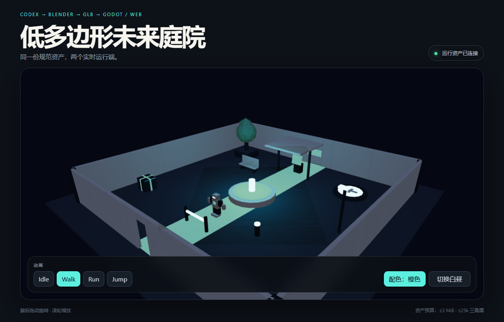
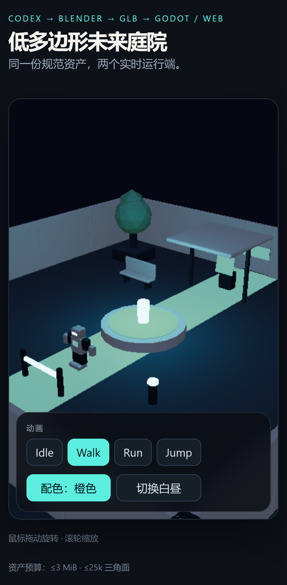

# AI3D · 低多边形未来庭院

一个可查看源码和资产证据的跨端3D示例：用固定种子与Blender脚本制作庭院模块、十种道具和角色，让**同一对GLB**同时用于Godot第三人称场景和React/Three.js交互查看器。



[打开交互预览](https://yangwei251003.github.io/ai3d-future-courtyard/) · [静态模式](https://yangwei251003.github.io/ai3d-future-courtyard/?forceFallback=1) · [原始程序转台成片](docs/media/turntable-original.mp4)

**状态：独立运行示例已验证，完整MCP生产流水线未重新验收。** 本次没有重新造型、生成动画或提升候选模型。公开版整理了可移植预览与隐私元数据；G0–G7仍需用户自己的工具、桥接和权限环境，不能由本次Web/Godot局部检查代替。

## 直接运行

在线页面无需本地服务。交互需要支持WebGL2的浏览器；不支持时可打开上方静态模式。

本地准备Node24和Git，在仓库根目录：

```powershell
npm ci
npm --prefix web ci
npm --prefix web run build
npm --prefix web run preview
```

按终端地址打开浏览器。Web可拖动旋转、滚轮缩放，切换Idle/Walk/Run/Jump、配色与昼夜。

Godot准备4.7.2 standard并将程序加入PATH，然后：

```powershell
godot --headless --path . --import
godot --path .
```

也可在项目管理器导入根`project.godot`。WASD移动、Shift奔跑、Space跳跃、L切换昼夜。Blender源用5.2.1打开`blender/checkpoints/`；运行两端不需要Blender、MCP或云端账号。

## 内容与技术

| 内容 | 当前资产 |
|---|---|
| 庭院 | 24×24米虚拟场景、五类模块、十种道具、碰撞/导航代理 |
| 角色 | 1.8米比例、11骨骼、四段动画 |
| 两规范GLB总计 | 517,300字节、6,532三角面、7材质、0图像纹理 |
| 技术 | Blender/Python、glTF2、Godot/GDScript、React/TypeScript、React Three Fiber/Drei/Three.js、Vite/Playwright |

Blender为Z-up、米单位，GLB为Y-up；消费端只改灯光和克隆后的材质值，不添加补偿性几何旋转。Web构建复制规范文件，Godot直接导入；用SHA-256证明字节一致，不能只比较文件名。



## 目录与保全范围

```text
assets/briefs/ schemas/    需求与数据约定
assets/runtime/           两份普通Git完整GLB与静态预览图
assets/manifests/         当前资产与校验指针
blender/scripts/          自有程序造型、导出和渲染源
blender/checkpoints/      四阶段.blend及四份.blend1原生保全
blender/renders/          七张固定真实渲染，去除个人路径元数据
game/                     Godot场景、控制与既有烟测
web/                      交互查看器源码与既有E2E
tools/                    独立资产检查及原生产工具源
docs/validation/          可随仓库读取的当前校验证据
```

所有必要二进制均小于GitHub普通文件限制，已去除LFS过滤器；正常clone即可获得完整资产。Git不收node_modules、.godot、dist、真实.codex/.mcp配置、机器日志、候选重复导出或48张转台中间帧。保留最终转台MP4；原项目和历史中间文件本地未删除。

## 检查与生产边界

独立GLB检查：`node tools/check-assets.mjs`。既有Godot检查：`godot --headless --path . --script res://game/tests/smoke_test.gd`。Web检查：`npm --prefix web run test:e2e`，需要安装Chrome；测试只用独立临时上下文并拒绝接用其他本机服务。

原`tools/doctor.ps1`、`build-asset.ps1`、`verify-all.ps1`属于受管MCP生产环境，额外依赖本地桥接、CAD Viewer、Codex等配置。它们不是首次下载后的简单运行入口。**不要在已保全检查点中直接重跑生成器**：原造型脚本会写固定阶段文件；应在新建空作者工作区中生成候选，经过相应完整门禁后再决定提升。本次未执行重建或生产提升，也未验证CAD/MCP连接。

本次原生模型读回、几何/动画一致性、Khronos结构验证、Godot逻辑和Web子路径检查范围见[VALIDATION.md](VALIDATION.md)。工具限制与后续事项写在[CHANGELOG.md](CHANGELOG.md)。

## 来源与许可

程序造型、自有代码和资产按[MIT](LICENSE)公开。模型来源、元数据清理及缓存排除见[PROVENANCE.md](PROVENANCE.md)；外部库与解码器保留[各自许可](THIRD_PARTY_NOTICES.md)。原MCP配置、账号资料和机器收据未公开；不能据此次局部验收删除原工程。
